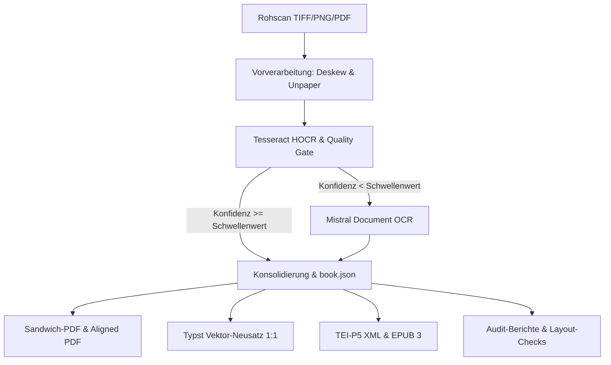

# 📚 Pipeline-Artefakte & Qualitätsstand

Die **AlexandriaSandwich-Pipeline** transformiert historische Drucke und Handschriften über ein mehrstufiges Hybridverfahren in unterschiedliche wissenschaftliche Ausgabeformate (Faksimiles, Sandwich-PDFs, TEI-P5, EPUB 3 und digitale Neusätze).

Diese Dokumentationsseite dient als zentrale Referenz aller erzeugten Artefakte, beschreibt deren Zweck und dokumentiert den aktuellen Qualitäts- und Reifegrad des Verfahrens für den kontinuierlichen Verbesserungsprozess (CIP).

---

## 1. Übersicht der Verarbeitungsstufen

---

## 2. Artefakt-Katalog

### 2.1 Vorverarbeitung & Bildbereinigung

#### `preprocessed/<job>/page_XXXX.png`
- **Pfad**: `data/processing/preprocessed/<job>/`
- **Zweck**: Vorbereitung der Rohscans für OCR und Faksimile-Erstellung. Führt Deskewing (Geraderücken), Randbereinigung (Unpaper), Bundsteg-Entschattung und Weißpunkt-Kompensation (Reinweiß) durch.
- **Qualitätsstand**:
  - *Stärken*: Homogene, gleichmäßige Weißflächen; Flecken und Scannerrauschen werden zuverlässig getrennt, ohne feine diakritische Punkte (Anusvāra, ṛ, ḍ) abzutrennen.
  - *Herausforderungen*: Bei stark gewölbten Buchrücken (Gutter Distortion) stößt rein lineares Deskewing an Grenzen; hier ist ggf. eine zylindrische Entzerrung erforderlich.

---

### 2.2 OCR-, Transkriptions- & Bounding-Box-Schichten

#### `page_XXXX.hocr` & `page_XXXX.json` (Tesseract)
- **Pfad**: `data/processing/qc/<job>/`
- **Zweck**: Schnelle lokale Primärerkennung auf Wort- und Zeichenebene inklusive genauer geometrischer Bounding-Boxes (`bbox x0 y0 x1 y1`) und Konfidenzwerten zur Steuerung des Quality-Gates.
- **Qualitätsstand**:
  - *Stärken*: Liefert exakte Koordinaten für jedes erkannte Wort auf der Originalseite.
  - *Herausforderungen*: Bei komplexen indologischen Texten (IAST-Diakritika, vedische Akzente, Devanagari) liegt die Trefferquote oft unter 85 %, was fehlerhafte Textlayer erzeugt.

#### `page_XXXX.mistral.md` & `page_XXXX.mistral.json` (Mistral Document OCR)
- **Pfad**: `data/output/<job>/markdown/`
- **Zweck**: KI-gestütztes Fallback- und High-Fidelity-OCR für Seiten, die das Tesseract-Quality-Gate nicht bestehen, sowie für anspruchsvolle Tabellen, Fußnoten und Diakritika.
- **Qualitätsstand**:
  - *Stärken*: Nahezu fehlerfreie Erkennung von IAST (ā, ī, ū, ṛ, ṝ, ḷ, ṃ, ḥ, ṅ, ñ, ṭ, ḍ, ṇ, ś, ṣ), Devanagari und vedischen Akzenten. Tabellenstrukturen werden semantisch erfasst.
  - *Herausforderungen*: Mistral interpretiert typografische Sonderheiten (z.B. Punktleisten im Inhaltsverzeichnis) gelegentlich als lange Punktfolgen oder Gleichheitszeichen. Zudem fehlen im Standard-Markdown Bounding-Box-Koordinaten für jedes einzelne Wort.

#### `page_XXXX.sidecar.txt`
- **Pfad**: `data/output/<job>/`
- **Zweck**: Bereitstellung des rohen Volltexts pro Seite für externe Suchmaschinen (Elasticsearch/Solr) und Unix-Tooling (`grep`).
- **Qualitätsstand**: Vollständig und performant abrufbar; entspricht exakt dem verifizierten Textbestand.

---

### 2.3 Semantische Konsolidierung & Buchmodell

#### `book.json` (`consolidate_book.py`)
- **Pfad**: `data/output/<job>/book.json`
- **Zweck**: Das zentrale, kanonische Datenmodell (Single Source of Truth). Führt Metadaten, Seitenfolgen, Tesseract-Koordinaten, Mistral-Markdown, Absatzhierarchien, Tabellen und Fußnoten in einem einheitlichen JSON-Schema zusammen.
- **Qualitätsstand**:
  - *Stärken*: Ermöglicht die saubere Entkopplung von Ingestion und Rendering; Basis für alle Folgeformate (PDF, TEI, EPUB).
  - *Herausforderungen*: Die automatische Unterscheidung zwischen Kolumnentiteln und beginnendem Haupttext erfordert bei uneinheitlichen Vorlagen gelegentlich seitenbezogene Heuristiken.

#### `toc.json` / `toc.txt` (`inject_toc.py`)
- **Pfad**: `data/output/<job>/<job>.toc.txt` (editierbar), `data/output/<job>/toc.json`
- **Zweck**: Hierarchischer Inhaltsbaum mit Seitenzuordnungen zur automatischen Injektion von PDF-Lesezeichen (Outlines/Bookmarks), PDF-Metadaten und echten Page-Labels (römisch für Front Matter, arabisch für Textteil).
- **TOC Outline & Quality-Gate**:
  - *Automatisierte Injektion*: Alle erzeugten PDFs (Faksimile, Sandwich, Vektor-Neusatz) werden über `inject_toc.py` mit Inhaltsverzeichnis und Page-Labels ausgestattet. Als Datenquelle dient vorrangig eine vorliegende `<job>.toc.txt` (oder `<job>.toc.json`) bzw. als automatischer Fallback die in `book.json` erfassten Kapitelüberschriften (`h1`/`h2`).
  - *Validierung & Normalisierung*: Die Hierarchiestufen werden automatisch normalisiert (Start bei Ebene 1, kein Überspringen von Zwischenstufen), um Fehler beim Setzen der PDF-Outlines auszuschließen.
  - *Warnung bei leerer Outline*: Werden 0 Einträge gefunden, protokolliert das Gate eine deutliche Warnung (`Warning: Injected 0 hierarchical TOC entries`); bei gesetztem `--require-toc` bricht der Schritt mit Fehlercode 1 ab.
  - *Manuelle Korrigierbarkeit (`.toc.txt`)*: Neben dem PDF wird eine einfache Klartextdatei `<job>.toc.txt` bereitgestellt (Syntax: `Titel | Seitennummer` mit 2 Leerzeichen Einrückung pro Ebene). Diese kann vom Benutzer in jedem Texteditor manuell verfeinert und über `python3 scripts/inject_toc.py -i <pdf> --toc <job>.toc.txt` ohne Neukompilierung verlustfrei re-injiziert werden.
- **Qualitätsstand**: Ermöglicht eine barrierefreie, standardisierte Navigationsleiste in PDF-Betrachtern (Apple Preview, Acrobat, PDF.js) mit 1:1 übereinstimmenden Seitenzahlen.

---

### 2.4 Faksimile- & Sandwich-PDF-Artefakte

#### `<job>.sandwich.pdf` (`assemble_sandwich.py`)
- **Pfad**: `data/output/<job>/<job>.sandwich.pdf`
- **Zweck**: Klassisches PDF-Sandwich: Bereinigtes Faksimile-Bild oben, unsichtbare OCR-Textschicht dahinter.
- **Qualitätsstand**: Solide für Volltextsuche und rudimentäres Kopieren; Textauswahl kann bei ungenauen Tesseract-Boxen leicht versetzt sein.

#### `<job>.aligned.pdf` (`align_mistral_pdf.py`)
- **Pfad**: `data/output/<job>/<job>.aligned.pdf`
- **Zweck**: Hybrides Faksimile-Sandwich. Ersetzt den fehleranfälligen Tesseract-Text durch den präzisen Mistral-Text und richtet ihn über Dynamic Time Warping (DTW) auf die Bounding-Boxes der Originalwörter aus.
- **Qualitätsstand**:
  - *Stärken*: Höchste Textqualität im Faksimile; seltene Ligaturen und Sonderzeichen lassen sich exakt markieren und kopieren.
  - *Herausforderungen*: Bei stark abweichender Segmentierung zwischen OCR-Engines sind Fallbacks auf Zeilen- oder Absatzboxen nötig.

#### `<job>.perfect_sandwich.pdf` (`build_perfect_sandwich.py`)
- **Pfad**: `data/output/<job>/<job>.perfect_sandwich.pdf`
- **Zweck**: Druckfertiges High-End-Faksimile mit adaptiver Hintergrundaufhellung, Schärfung (Unsharp Mask), Content-Aware Margin Masking (automatische Beseitigung von Buchfalzen, Schatten, Bindestreifen und Scannerkanten außerhalb des Textbereichs) sowie unsichtbarem Vektor-Textlayer (Mode 3).
- **Verfahren (Content-Aware Margin Masking)**:
  - Ermittelt die exakte Bounding-Box des Textkörpers dynamisch aus den Mistral-JSON-Koordinaten oder PyMuPDF-Wortvektoren.
  - Wendet mehrskaliges Ausleuchtungs-Leveling und Hintergrund-Nivellierung auf Reinweiß (`#FFFFFF`) an.
  - Maskiert alle zusammenhängenden Schatten-, Falz- und Buchrückenflächen außerhalb der Textgrenzen (`pad_x=75, pad_y=60`), ohne Randnotizen oder Seitenzahlen anzutasten.
- **Qualitätsstand**: Optisch dem Rohscan weit überlegen; dient als bereinigte Referenzbasis für die nachgelagerte Layout-Profilierung und den Neusatz.

---

### 2.5 Digitaler Neusatz & Vektor-Editionen (Typst)

#### `layout.profile.json` (`profile_source_layout.py`)
- **Pfad**: `data/output/<job>/layout.profile.json`
- **Zweck**: Automatisierte geometrische Vermessung des Quell-Faksimiles (`perfect_sandwich.pdf`). Ermittelt Satzspiegel, Randabstände (Kopf, Fuß, Innen, Außen), Durchschuss, Makro-Layout (einspaltig, zweispaltig, Marginalspalten) sowie Paginierungs- und Kolumnentitel-Positionen.
- **Qualitätsstand**: Vollautomatisch; liefert die kalibrierten Geometrieparameter für den Neusatz.

#### `<job>.digital.typ` & `<job>.digital.pdf` (`render_digital_pdf.py`)
- **Pfad**: `data/output/<job>/<job>.digital.pdf`
- **Zweck**: Vollständiger digitaler Neusatz als Vektordokument (kein Rasterscan). Verlustfrei skalierbar, barrierefrei und mit echten Schriften gerendert (Libertinus Serif, Noto Sans Devanagari).
- **Typografische Standards**:
  - *Satzspiegel & Durchschuss*: Wird automatisch aus `layout.profile.json` und `.perfect_sandwich.pdf` abgeleitet.
  - *Titel & Absätze*: Dokumententitel zentriert auf Satzspiegelmitte; strukturierter Erstzeileneinzug (`1.5em`) für Textabsätze.
  - *Kopfzeile & Paginierung*: Symmetrischer Drei-Spalten-Kolumnentitel mit konsistenter Devanāgarī- oder arabischer Seitenzählung.
  - *Fußnoten-Apparat*: Automatische Abtrennung und Formatierung von Anmerkungen am Seitenende mit horizontaler Trennlinie und verkleinertem Schriftgrad.
- **Modi**:
  - *1:1 Seitenkongruenz (`--preserve-pages`)*: Jede Buchseite beginnt auf einer neuen digitalen Seite mit identischen Kolumnentiteln und adaptiver Skalierung (`page_content`), sodass die Paginierung exakt dem historischen Original entspricht.
  - *Scholarly Reflow*: Fließender Neusatz mit harmonischen Buchumbüchen nach klassischem typografischem Satzspiegel.
- **Qualitätsstand**:
  - *Stärken*: Gestochen scharfes Schriftbild, minimale Dateigröße (ca. 200–800 KB statt 20–50 MB beim Faksimile), vollständige Durchsuchbarkeit.

---

### 2.6 Interoperabilitäts- & Distributionsformate

#### `<job>.tei.xml` (`export_tei.py`)
- **Pfad**: `data/output/<job>/<job>.tei.xml`
- **Zweck**: TEI-P5-konformes XML für Digital Humanities, Computerlinguistik und Langzeitarchivierung nach TEI-Konsortiumsstandard.
- **Qualitätsstand**: Valides TEI-XML mit strukturierter Titelei, Divisionen (`
`), Paragraphen (`
`) und Zeilenumbrüchen (`<lb/>`). Tiefergehende morphosyntaktische Annotationen können nachgelagert über NLP-Pipelines angereichert werden.

#### `<job>.epub` (`export_epub.py`)
- **Pfad**: `data/output/<job>/<job>.epub`
- **Zweck**: Reflowfähiges E-Book für mobile Lesegeräte (Apple Books, Kindle, Tolino) basierend auf semantischem XHTML5 und CSS.
- **Qualitätsstand**:
  - *Stärken*: Fließtext und einfache Listen passen sich jeder Bildschirmgröße optimal an.
  - *Herausforderungen*: Breite grammatikalische Paradigmen (Deklinations- und Konjugationstabellen) erfordern horizontales Scrollen oder kompakte CSS-Sonderregeln.

---

### 2.7 Diagnose- & Qualitätsaudits

#### `<job>.report.md` (`generate_job_report.py`)
- **Pfad**: `data/output/<job>/<job>.report.md`
- **Zweck**: Automatisierte Zusammenfassung eines Pipeline-Laufs mit Kennzahlen (Pass/Fail-Verhältnis Tesseract vs. Mistral, Verarbeitungszeiten, Dateigrößen, Checksummen).
- **Qualitätsstand**: Dient als deterministisches Quality-Gate im n8n-/Shell-Workflow und wird direkt in der Web-UI dargestellt.

#### `<job>.layout_audit.json` / `<job>.layout_audit.md` (`audit_layout_concordance.py`)
- **Pfad**: `data/output/<job>/<job>.layout_audit.md`, `data/output/<job>/<job>.layout_audit.json`
- **Zweck**: Automatisierter Soll-Ist-Vergleich zwischen Original-Faksimile (`perfect_sandwich.pdf`) und Neusatz (`digital.pdf`). Berechnet Satzspiegel-Ausfüllrate (Fill Ratio), Whitespace-Divergenz, strukturelle Zonen-Konkordanz (Marginalien vs. Hauptspalte), horizontale Massenschwerpunkte und Jaccard-Token-Überlappung.
- **Qualitätsstand**: Unverzichtbares Instrument für das automatisierte Layout-Quality-Gate.

#### `comparison_samples/` (`compare_layout.py`)
- **Pfad**: `data/output/<job>/comparison_samples/page_XXXX_comparison.png`
- **Zweck**: Visuelle Side-by-Side-Gegenüberstellung des bereinigten Faksimiles (links) und des digitalen Neusatzes (rechts) zur schnellen visuellen Begutachtung von Satzspiegel, Umbrüchen und Paginierung.
- **Qualitätsstand**: Wird standardmäßig im Pipeline-Lauf erzeugt.

---

## 3. Qualitätsmatrix & Reifegrad-Dashboard

| Stufe / Artefakt | Automatisierungsgrad | Reifegrad | Primäre Stärke | Aktuelle Herausforderung |
| :--- | :--- | :--- | :--- | :--- |
| **Preprocessed PNG** | 100 % automatisch | Reif (Produktion) | Gleichmäßige Weißflächen | Gewölbter Bundsteg |
| **OCR / Mistral MD** | 100 % automatisch | Sehr hoch | Diakritika-Präzision | Semantik von Punktleisten/Layout |
| **book.json** | 100 % automatisch | Hoch | Zentrales Schnittstellenmodell | Header- vs. Body-Klassifikation |
| **TOC Outline & Labels**| 100 % automatisch / Manuell | Publikationsreif | Standard-Lesezeichenbaum & Paginierung | Feingliederung tiefer Paragraphen |
| **Aligned Sandwich PDF**| 100 % automatisch | Hoch | Textsuche im Faksimile | Token-Drift bei Ligaturen |
| **1:1 Typst Neusatz** | Halbautomatisch / CIP | Publikationsreif | Ästhetik & Zitierfähigkeit | Manuelle Feineinstellung bei Tabellen |
| **TEI-P5 XML** | 100 % automatisch | Gut | Interoperabilität | Morphosyntaktische Tiefe |
| **EPUB 3** | 100 % automatisch | Befriedigend | Mobiles Lesen | Komplexe Grammatiktabellen |

---

## 4. Release-Assoziation & Künftige Fortschritte

- **Release v1.4.0 (Minor Release)**:
  - Erstmalige Verankerung des strengen 1:1 Vektor-Neusatzes (`build_macdonell_full_1to1.py`) über das gesamte Werk (520 Seiten) als regulärer Pipeline-Bestandteil.
  - Verbindliches **TOC-Outline-Quality-Gate**: Automatisierte Prüfung aller PDFs auf Lesezeichenbäume, Generierung/Injektion inklusive echter Page-Labels (i–xii, 1–508) und Bereitstellung editierbarer `.toc.txt`-Dateien zur manuellen Korrektur.
  - Einführung des tabularen Clarendon-Punktrasters und historischer Mediäval-Kapitälchen.
  - Etablierung des standardisierten Artefakt-Inventars und der CIP-Dokumentation.
- **Künftige Zyklen**:
  - Künftige Optimierungen an Bounding-Box-Ausrichtung, automatischen Tabellenlayouts und TEI-Anreicherungen werden kontinuierlich in dieser Matrix fortgeschrieben.
