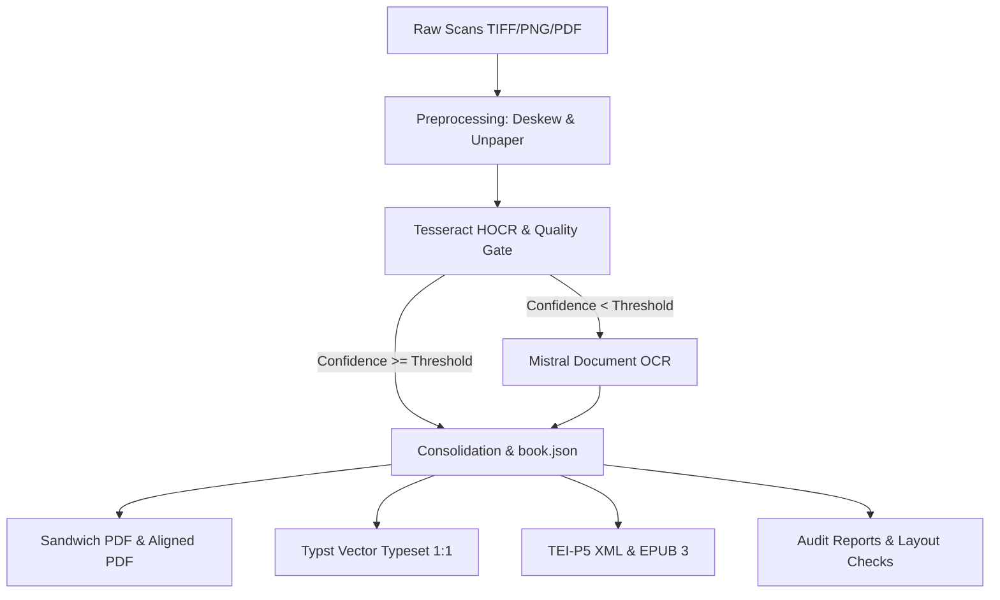

# 📚 Pipeline Artifacts & Quality Status

The **AlexandriaSandwich pipeline** transforms historical print editions and manuscripts via a multi-stage hybrid workflow into various scholarly publication formats (facsimiles, sandwich PDFs, TEI-P5 XML, EPUB 3, and digital vector typeset editions).

This documentation page serves as the canonical reference for all generated artifacts, details their purpose, and documents the current quality and maturity levels of each stage to guide the continuous improvement process (CIP).

---

## 1. Processing Stages Overview

---

## 2. Artifact Catalog

### 2.1 Preprocessing & Image Enhancement

#### `preprocessed/<job>/page_XXXX.png`
- **Path**: `data/processing/preprocessed/<job>/`
- **Purpose**: Prepares raw scans for OCR and facsimile generation via deskewing, unpaper border cleaning, gutter shadow suppression, and pure white leveling.
- **Quality Status**:
  - *Strengths*: Highly uniform, clean white backgrounds; reliable separation of paper noise without clipping delicate diacritic marks (Anusvāra, ṛ, ḍ).
  - *Challenges*: Severe book spine gutter curvature limits linear deskewing; cylindrical warping correction is planned for extreme cases.

---

### 2.2 OCR, Transcription & Bounding-Box Layers

#### `page_XXXX.hocr` & `page_XXXX.json` (Tesseract)
- **Path**: `data/processing/qc/<job>/`
- **Purpose**: Fast local primary recognition at token and glyph level, producing geometric bounding boxes (`bbox x0 y0 x1 y1`) and confidence scores driving the quality gate.
- **Quality Status**:
  - *Strengths*: Supplies exact coordinate geometry for every token detected on the original scan.
  - *Challenges*: Complex Indological scripts (IAST diacritics, Vedic accents, Devanagari) frequently fall below 85% confidence, creating corrupted text layers without fallbacks.

#### `page_XXXX.mistral.md` & `page_XXXX.mistral.json` (Mistral Document OCR)
- **Path**: `data/output/<job>/markdown/`
- **Purpose**: AI-powered fallback and high-fidelity transcription for pages failing the Tesseract gate, as well as complex tables, footnotes, and polytonic diacritics.
- **Quality Status**:
  - *Strengths*: Near-flawless accuracy on IAST (ā, ī, ū, ṛ, ṝ, ḷ, ṃ, ḥ, ṅ, ñ, ṭ, ḍ, ṇ, ś, ṣ), Devanagari, and Vedic accents. Structural table parsing.
  - *Challenges*: Dense leader dot sequences in tables of contents may be rendered as raw punctuation runs. Standard Markdown omits per-token coordinate boxes.

#### `page_XXXX.sidecar.txt`
- **Path**: `data/output/<job>/`
- **Purpose**: Clean plaintext stream per page for external indexing (Elasticsearch, Solr) and command-line grep utilities.
- **Quality Status**: Complete, fast, and directly synchronized with verified textual corpora.

---

### 2.3 Semantic Consolidation & Canonical Book Model

#### `book.json` (`consolidate_book.py`)
- **Path**: `data/output/<job>/book.json`
- **Purpose**: Canonical single-source-of-truth data model unifying metadata, pagination, Tesseract coordinates, Mistral markdown, paragraph hierarchies, tables, and footnotes in a validated JSON schema.
- **Quality Status**:
  - *Strengths*: Decouples ingestion from multi-format rendering; primary source for PDF, TEI, and EPUB export.
  - *Challenges*: Differentiating between running headers and opening body text occasionally requires page-level heuristics on heterogeneous prints.

#### `toc.json` / `toc.txt` (`inject_toc.py`)
- **Path**: `data/output/<job>/<job>.toc.txt` (editable), `data/output/<job>/toc.json`
- **Purpose**: Hierarchical table of contents tree with page mappings for automated injection of PDF bookmarks/outlines, PDF metadata, and authentic page labels (Roman for front matter, Arabic for main text).
- **TOC Outline & Quality Gate**:
  - *Automated Injection*: All produced PDFs (facsimile, sandwich, vector typeset) are populated with bookmarks and page labels via `inject_toc.py`. The primary data source is an existing `<job>.toc.txt` (or `<job>.toc.json`), with an automatic fallback to chapter headings (`h1`/`h2`) extracted from `book.json`.
  - *Validation & Normalization*: Hierarchy levels are normalized automatically (starting at level 1 without skipped intermediate levels) to eliminate bookmark rendering errors.
  - *Empty Outline Warning*: If zero entries are detected, the gate logs a warning (`Warning: Injected 0 hierarchical TOC entries`); when `--require-toc` is set, the step exits with code 1.
  - *Manual Editorial Control (`.toc.txt`)*: An accessible plain text file `<job>.toc.txt` is provided alongside the PDF (syntax: `Title | PageNumber` with 2 spaces indentation per level). Scholars can edit titles and page targets in any standard text editor and re-inject them losslessly within seconds using `python3 scripts/inject_toc.py -i <pdf> --toc <job>.toc.txt`.
- **Quality Status**: Fully operational; provides standard accessible navigation across PDF viewers (Apple Preview, Acrobat, PDF.js) with 1:1 matching book page numbers.

---

### 2.4 Facsimile & Sandwich PDF Artifacts

#### `<job>.sandwich.pdf` (`assemble_sandwich.py`)
- **Path**: `data/output/<job>/<job>.sandwich.pdf`
- **Purpose**: Standard searchable PDF sandwich combining preprocessed page images with invisible Tesseract HOCR text layers.
- **Quality Status**: Dependable for keyword search and basic copy-pasting; bounding boxes can drift slightly under damaged fonts.

#### `<job>.aligned.pdf` (`align_mistral_pdf.py`)
- **Path**: `data/output/<job>/<job>.aligned.pdf`
- **Purpose**: High-fidelity hybrid sandwich aligning high-accuracy Mistral OCR tokens to Tesseract bounding boxes via Dynamic Time Warping (DTW).
- **Quality Status**:
  - *Strengths*: Highest text extraction fidelity in facsimile format; rare ligatures and complex diacritics select and copy reliably.
  - *Challenges*: Large tokenization discrepancies between engines require occasional fallback to line-level boxes.

#### `<job>.perfect_sandwich.pdf` (`build_perfect_sandwich.py`)
- **Path**: `data/output/<job>/<job>.perfect_sandwich.pdf`
- **Purpose**: Archival print-ready facsimile with adaptive contrast leveling, unsharp masking, content-aware margin masking (automated suppression of gutter shadows, binding strips, and scanning edges outside text boundaries), and invisible vector text layers (Render Mode 3).
- **Procedure (Content-Aware Margin Masking)**:
  - Dynamically extracts exact text bounding boxes per page from Mistral JSON geometry or word vectors.
  - Applies multiscale illumination background subtraction and leveling to pure white (`#FFFFFF`).
  - Masks contiguous gutter folds and scanner edges outside text boundaries (`pad_x=75, pad_y=60`) without clipping marginalia or page numbers.
- **Quality Status**: Visually superior to raw archive scans; serves as the clean reference baseline for layout profiling and digital typesetting.

---

### 2.5 Digital Vector Typeset Editions (Typst)

#### `layout.profile.json` (`profile_source_layout.py`)
- **Path**: `data/output/<job>/layout.profile.json`
- **Purpose**: Automated geometric profiling of the source facsimile (`perfect_sandwich.pdf`). Measures text column dimensions (Satzspiegel), page margins (top, bottom, inner, outer), leading/line spacing, macro layout structure (single-column, two-column, marginal sideheads), and header/folio coordinates.
- **Quality Status**: Fully automated; feeds calibrated geometric parameters into the typesetting renderer.

#### `<job>.digital.typ` & `<job>.digital.pdf` (`render_digital_pdf.py`)
- **Path**: `data/output/<job>/<job>.digital.pdf`
- **Purpose**: Pure vector-based digital re-typesetting (not a raster image). Infinitely scalable, accessible, and rendered using authentic typefaces (Libertinus Serif, Noto Sans Devanagari).
- **Typographic Standards**:
  - *Satzspiegel & Spacing*: Calibrated automatically from `layout.profile.json` and `.perfect_sandwich.pdf`.
  - *Title & Paragraphs*: Centered title block; structured first-line indentation (`1.5em`) on body text.
  - *Header & Folio*: Symmetrical three-column running headers with consistent Devanāgarī or Arabic page numbering.
  - *Footnote Separation*: Automated extraction and bottom-of-page formatting with hairline divider rules and reduced point sizes.
- **Modes**:
  - *1:1 Original Page Correspondence (`--preserve-pages`)*: Every page starts on a new digital page matching original page numbers and headers, scaled adaptively via `page_content` to guarantee exact page parity.
  - *Scholarly Reflow*: Continuous re-typesetting with natural book breaks according to classical typographic proportions.
- **Quality Status**:
  - *Strengths*: Razor-sharp typography, lightweight file size (200–800 KB vs. 20–50 MB for facsimiles), complete full-text accessibility.

---

### 2.6 Interoperability & Distribution Formats

#### `<job>.tei.xml` (`export_tei.py`)
- **Path**: `data/output/<job>/<job>.tei.xml`
- **Purpose**: TEI-P5 compliant XML export for Digital Humanities, computational linguistics, and long-term archival preservation according to Text Encoding Initiative standards.
- **Quality Status**: Valid TEI-P5 with structured headers, divisions (`
`), paragraphs (`
`), and line breaks (`<lb/>`). Linguistic tagging can be added in downstream NLP pipelines.

#### `<job>.epub` (`export_epub.py`)
- **Path**: `data/output/<job>/<job>.epub`
- **Purpose**: Reflowable EPUB 3 e-book for mobile e-readers (Kindle, Apple Books, Kobo) with semantic XHTML5 markup.
- **Quality Status**:
  - *Strengths*: Smooth reflow and customizable typography on handheld devices.
  - *Challenges*: Wide grammar tables (paradigms of declensions/conjugations) require specialized responsive CSS.

---

### 2.7 Diagnostics & Quality Audits

#### `<job>.report.md` (`generate_job_report.py`)
- **Path**: `data/output/<job>/<job>.report.md`
- **Purpose**: Automated end-of-run quality audit with pass/fail ratios, OCR confidence distributions, runtime metrics, and SHA-256 artifact checksums.
- **Quality Status**: Serves as a deterministic gate in n8n pipelines and renders directly inside the web UI.

#### `<job>.layout_audit.json` / `<job>.layout_audit.md` (`audit_layout_concordance.py`)
- **Path**: `data/output/<job>/<job>.layout_audit.md`, `data/output/<job>/<job>.layout_audit.json`
- **Purpose**: Automated concordance gate comparing the cleaned facsimile (`perfect_sandwich.pdf`) against digital vector typesetting (`digital.pdf`). Computes fill ratio, whitespace divergence, structural zone concordance, horizontal center-of-mass, and Jaccard token overlap.
- **Quality Status**: Indispensable automated layout gate.

#### `comparison_samples/` (`compare_layout.py`)
- **Path**: `data/output/<job>/comparison_samples/page_XXXX_comparison.png`
- **Purpose**: Visual side-by-side verification images showing cleaned facsimile (left) versus digital typesetting (right) for instant inspection of Satzspiegel, line breaks, and page boundaries.
- **Quality Status**: Generated automatically in every standard pipeline run.

---

## 3. Quality Matrix & Maturity Dashboard

| Stage / Artifact | Automation Level | Maturity Level | Primary Strength | Current Focus |
| :--- | :--- | :--- | :--- | :--- |
| **Preprocessed PNG** | 100% automated | Mature (Production) | Clean white surfaces | Severe gutter curvature |
| **OCR / Mistral MD** | 100% automated | Very High | Diacritics accuracy | Leader dot semantic parsing |
| **book.json** | 100% automated | High | Unified schema model | Running header discrimination |
| **TOC Outline & Labels**| 100% automated / Manual | Publication-Grade | Standard bookmark tree & page labels | Deep section granularity |
| **Aligned Sandwich PDF**| 100% automated | High | Exact facsimile search | Complex ligature token-drift |
| **1:1 Typst Neusatz** | Semi-automated / CIP | Publication-Grade | Exact 1:1 page citations | Responsive paradigm tables |
| **TEI-P5 XML** | 100% automated | Good | Interoperability | Morphosyntactic annotation |
| **EPUB 3** | 100% automated | Adequate | Mobile reflow | Multi-column tabular layouts |

---

## 4. Release Association & Future Progress

- **Release v1.4.0 (Minor Release)**:
  - Integration of strict 1:1 page-fidelity digital typesetting (`build_macdonell_full_1to1.py`) across the complete 520-page volume.
  - Mandatory **TOC Outline Quality Gate**: Automated auditing of all generated PDFs for outline bookmarks, injection of authentic page labels (i–xii, 1–508), and generation of human-editable `.toc.txt` files.
  - Implementation of right-anchored tabular Clarendon leader dots and Mediæval Small Capitals.
  - Formalization of this artifact catalog and quality matrix.
- **Future Cycles**:
  - Subsequent improvements in bounding-box alignment, automated table restructuring, and TEI linguistic tagging will be documented incrementally in this matrix.
